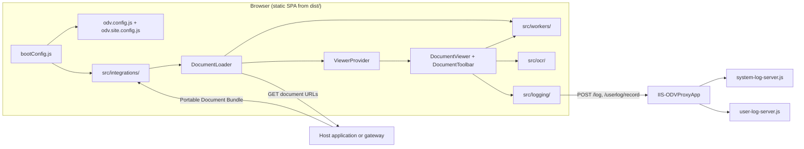
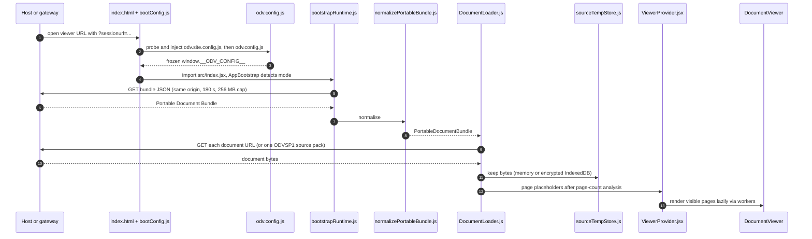
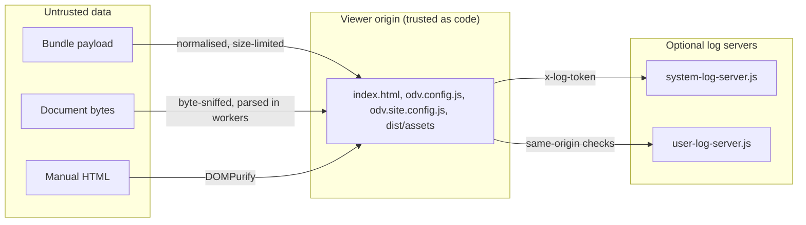
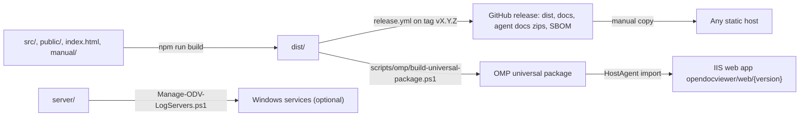

# Architecture

OpenDocViewer is a static browser application that displays documents a host hands to it. It has
no server-side component of its own at runtime. Everything it needs at runtime is static files plus
the document URLs the host provides. Two optional Node log servers and an optional IIS proxy app
exist for logging only.

This is the one architecture description for the repository. It is written for a newcomer, for a
customer's architect and for an AI agent. Every statement names the file or folder it comes from.
Statements that could not be checked from this repository are marked **unverified**. Detail that
already has its own document is linked, not repeated:

| Topic | Owning document |
| --- | --- |
| Host contract (Portable Document Bundle, file URLs, metadata) | `docs-src/integrations.md` |
| Every runtime configuration key | `docs-src/runtime-configuration.md` |
| IIS hosting, cache rules, CSP tightening, checklists | `docs-src/deploy-ops.md` |
| Log server endpoints, files and environment | `docs-src/log-servers.md` |
| Print pipeline | `docs-src/printing.md` |
| PDF signature inspection | `docs-src/pdf-signatures.md` |
| OMP versions and manifests | `docs-src/omp-component-manifest.md` |
| Release numbering and maintained lines | `docs-src/CODEX_DEVELOPMENT.md`, section "Versioning and Maintained Lines" |
| Security policy and supported versions | `SECURITY.md` |

Sections 1 to 10 describe the system as a whole. The sections after "Viewer internals" describe
how the code inside the browser is organised.

## 1. Purpose, scope and non-goals

OpenDocViewer shows PDF, TIFF, JPEG, PNG, JPEG XL and AVIF documents in a browser
(`README.md`, "What it is / what it is not"). It can run on its own with sample files, be embedded
in a host page, or be started by a host through a Portable Document Bundle
(`src/integrations/bootstrapRuntime.js`, `src/schemas/portableBundle.js`).

In scope:

- Loading a host-provided list of documents and showing them page by page
  (`src/components/DocumentLoader/`, `src/components/DocumentViewer/`).
- Navigation, zoom, compare views, image adjustments and thumbnails
  (`src/components/DocumentViewer/`, `src/components/DocumentThumbnailList.jsx`).
- Printing and PDF download generated in the browser (`src/utils/printUtils.js` and the modules it
  re-exports, `src/workers/pdfWorker.js`).
- Opt-in text layers: a PDF page's own text (`pdfTextLayer.enabled`) and in-browser OCR
  (`ocr.enabled`), both off by default (`public/odv.config.js`, `src/ocr/`).
- Level-1 PDF signature inspection without network access (`src/workers/pdfSignatureWorker.js`,
  `docs-src/pdf-signatures.md`).
- English and Swedish user interface (`public/locales/en/`, `public/locales/sv/`, `src/i18n.js`).
- Optional print-intent and diagnostic logging (`src/logging/`, `server/`).

Deliberately not in scope:

- **No authentication or authorisation.** The host decides who may see which document. The viewer
  shows what it is given (`docs-src/integrations.md`, "Goals"; `docs-src/CODEX_DEVELOPMENT.md`,
  "Integration Notes").
- **No document storage, archive or search engine.** Documents are fetched from host URLs and kept
  only in short-lived browser storage (section 4).
- **No editing or conversion service.** Generated PDFs exist only for printing and download.
- **No server-side OCR.** OCR runs in the browser (`src/ocr/engine.js`).
- **No certificate-chain trust or revocation checking** for PDF signatures
  (`docs-src/pdf-signatures.md`).
- **No review workflow state.** Approval, rejection and audit rules belong to the host
  (`docs-src/CODEX_DEVELOPMENT.md`, "Integration Notes").
- **No host-specific behaviour in viewer code.** Host specifics travel as optional bundle metadata
  or site configuration (`AGENTS.md`).

## 2. Components

The repository holds one deployable web application and a small set of optional companions.

| Component | Responsibility | Code | Depends on |
| --- | --- | --- | --- |
| Boot and configuration | Resolve the base path, load runtime configuration, then start React | `index.html`, `src/app/bootConfig.js`, `public/odv.config.js`, `src/utils/runtimeConfig.js` | Static host only |
| Application shell | Choose the startup mode, mount providers, show the demo launcher when no payload exists | `src/index.jsx`, `src/app/AppBootstrap.jsx`, `src/app/OpenDocViewer.jsx` | Configuration, integrations |
| Integrations | Read a bundle from the URL, the parent window, a token or the JS API, and normalise it | `src/integrations/` | Host page or same-origin bundle URL |
| Bundle schema | The neutral `PortableDocumentBundle` shape | `src/schemas/portableBundle.js` | None |
| Document loader | Order sources, prefetch bytes, detect types, count pages, insert placeholders | `src/components/DocumentLoader/` | `file-type`, `pdfjs-dist`, `utif2`, temp store |
| Viewer state | Page list, caches, object-URL lifetime, memory pressure | `src/contexts/ViewerProvider.jsx`, `src/contexts/viewerContext.js` | Loader, page-asset store |
| Viewer UI | Page display, navigation, zoom, compare, toolbar, dialogs | `src/components/DocumentViewer/`, `src/components/DocumentToolbar/`, `src/components/*.jsx` | Viewer state |
| Workers | Raster, TIFF and JPEG XL decoding; PDF page rendering; PDF generation; signature checks | `src/workers/imageWorker.js`, `pdfPageWorker.js`, `pdfWorker.js`, `pdfSignatureWorker.js` | `pdfjs-dist`, `utif2`, `jxl-oxide-wasm`, `jspdf`, `pdf-lib`, `pkijs`, `asn1js` |
| OCR and text layers | PDF text extraction and Tesseract OCR, both opt-in | `src/ocr/`, `src/components/OcrTextLayer.jsx` | `tesseract.js`, `tesseract.js-core` |
| Print | Print dialog, HTML iframe print, generated PDF | `src/utils/print*.js`, `src/components/DocumentToolbar/PrintRangeDialog.jsx`, `src/components/PrintSelectionWorkspace.jsx` | Viewer state, workers |
| Help and manual | Quick help, manual overlay, stand-alone manual page, About dialog | `src/components/DocumentToolbar/`, `src/components/Manual/`, `src/manual-page/`, `manual/index.html`, `public/help/` | `dompurify` |
| Logging clients | Send diagnostics and print intent when enabled | `src/logging/systemLogger.js`, `src/logging/userLogger.js` | Log endpoints (optional) |
| System log server | Accept token-gated diagnostics and write daily files | `server/system-log-server.js` | `express`, `helmet`, `cors`, `express-rate-limit`, `morgan` |
| User log server | Accept same-origin print-intent records and write daily files | `server/user-log-server.js` | Same as above, without `cors` |
| IIS proxy app | Forward the two log paths to the Node servers | `IIS-ODVProxyApp/web.config.template`, `scripts/Setup-IIS-ODVProxy.ps1` | IIS URL Rewrite and ARR |
| OMP packaging | Describe the web app as an OpenModulePlatform module and build packages | `omp-components.json`, `opendocviewer.module-definition.json`, `sql/3-initialize-opendocviewer.sql`, `build-omp-objects.ps1`, `scripts/omp/` | OpenModulePlatform checkout at build time |
| Site configuration generator | Build and re-check `odv.site.config.js` from the sample; not shipped | `tools/site-config-generator/` | Node |

`dependencies` in `package.json` mixes browser libraries and the log servers' libraries. The browser
bundle only includes what `src/` imports. `express`, `helmet`, `cors`, `morgan`, `dotenv` and
`express-rate-limit` are imported only by `server/`. `axios` is imported by the browser's system log
client (`src/logging/systemLogger.js`).

## 3. Runtime view

### Processes and hosts

| Process | Where it runs | Started by | Required |
| --- | --- | --- | --- |
| Viewer | The user's browser tab, plus Web Workers | Loading `index.html` | Yes |
| Static web host | IIS in the reference setup (`public/web.config`); any static host works (`README.md`) | Operator or OMP HostAgent | Yes |
| Host application or gateway | Outside this repository | Host | Only for real documents |
| System log server | Node, default port 3001 (`server/system-log-server.js`) | `npm run start:system-log`, or a Windows service from `scripts/Manage-ODV-LogServers.ps1` | No |
| User log server | Node, default port 3002 (`server/user-log-server.js`) | `npm run start:user-log`, or a Windows service | No |
| IIS proxy app | IIS application, default path `/ODVProxy` (`IIS-ODVProxyApp/README.md`) | `scripts/Setup-IIS-ODVProxy.ps1` | Only with the log servers |

### Flow 1: a host opens a document session

This is the main flow. The steps below use the session URL mode, which wins over every other mode.

Step by step:

1. The host builds a bundle and makes it reachable from the viewer origin
   (`docs-src/integrations.md`, "Host iframe preparation flow").
2. `index.html` loads `src/app/bootConfig.js`. It probes `odv.site.config.js` and `odv.config.js` and
   injects them only when the response has a JavaScript content type.
3. `public/odv.config.js` deep-merges the site file over its defaults, freezes the result and
   exposes it as `window.__ODV_CONFIG__`.
4. `src/app/AppBootstrap.jsx` calls the detection in `src/integrations/bootstrapRuntime.js`. The
   first source that yields at least one document wins (order in "Bootstrap responsibilities").
5. `src/integrations/sessionUrl.js` fetches the bundle with `credentials: 'same-origin'`.
6. `src/integrations/normalizePortableBundle.js` turns the payload into one
   `PortableDocumentBundle`.
7. `src/components/DocumentLoader/DocumentLoader.js` fetches every source with
   `credentials: 'same-origin'` and `cache: 'no-store'`, or one `ODVSP1` stream when the bundle sets
   `integration.sourcePackUrl` (`SOURCE_PACK_MAGIC` in the same file).
8. The loader detects the real file type from the bytes and rejects text-like answers such as login
   pages.
9. The loader counts pages and inserts placeholders into `ViewerContext`. Failed sources keep their
   position as error placeholders.
10. The viewer renders the visible pages and thumbnails on demand. Rendered pages are kept in
    `src/utils/pageAssetStore.js`.

When no source yields a document, the demo launcher in `src/app/AppBootstrap.jsx` opens instead.
An explicit `?sessionurl=` that fails does not fall through. It stays in demo mode with the
diagnosis `session-url-unavailable` (`src/integrations/bootstrapRuntime.js`).

### Flow 2: a user prints

1. The toolbar opens `PrintRangeDialog.jsx`. Printing stays disabled until every page has reached a
   loaded or failed state (`README.md`, "Printing").
2. The user picks scope, method and, when configured, reason and recipient.
3. `src/logging/userLogger.js` sends a print-intent record when `userLog.enabled` is true. It uses
   `sendBeacon`, or `fetch` with `keepalive`, and never blocks printing.
4. Direct mode prints through a hidden iframe (`src/utils/printCore.js`, `src/utils/printDom.js`).
   Safe mode generates a PDF with jsPDF, splits work across `src/workers/pdfWorker.js` above
   `print.pdf.workerPageThreshold` pages and merges the parts with pdf-lib (`src/utils/printPdf.js`).
5. When the user log is proxied, `IIS-ODVProxyApp` forwards `POST userlog/record` to
   `server/user-log-server.js`. The server writes one NDJSON line to `server/logs/print-YYYY-MM-DD.log`.

### Flow 3: the manual opens

`src/utils/manualSources.js` lists the candidate files: `help/site/` before `help/default/`, the UI
language before the fallback language. `ManualOverlayDialog.jsx` fetches them in that order with
`cache: 'no-store'`, skips an SPA fallback page, and sanitises the first real hit with DOMPurify.
`README.md`, "Manuals and help", has the sequence diagram.

## 4. Data

OpenDocViewer has no database of its own. It persists nothing on a server except the optional log
files.

| Data | Where | Format | Owner and lifetime |
| --- | --- | --- | --- |
| Documents | Host URLs | PDF, TIFF, JPEG, PNG, JPEG XL, AVIF; optionally an `ODVSP1` source pack | Host. The viewer only reads them. |
| Session bundle | Host URL, parent window, URL token or JS call | JSON, `PortableDocumentBundle` (`src/schemas/portableBundle.js`) | Host. Read once at startup. |
| Original source bytes | Memory, or IndexedDB database `OpenDocViewerTempStore`, store `sources` (`src/utils/sourceTempStore.js`) | Blobs; IndexedDB payloads wrapped with AES-GCM | Viewer session. Stale sessions are pruned after `staleSessionTtlMs`. |
| Rendered page images | Memory, or IndexedDB database `OpenDocViewerPageAssetStore`, store `assets` (`src/utils/pageAssetStore.js`) | Image blobs, same wrapping | Viewer session. |
| Reload-cache key | `localStorage`, `sessionStorage` as fallback, prefix `OpenDocViewer.reloadCacheKey.v1` (`src/utils/reloadCacheCrypto.js`) | AES key material | Only when `reloadCacheTtlMs` is above 0; at most 24 hours (`docs-src/runtime-configuration.md`, "Document-Version Reload Cache"). |
| Viewer preferences | `localStorage` and a same-origin cookie (`src/utils/viewerPreferences.js`) | JSON | User's browser. Image adjustments are never stored. |
| Shared OMP theme | `localStorage` and a cookie (`src/utils/ompThemePreference.js`) | JSON | User's browser. |
| Language and locale version | `localStorage` keys `i18nextLng` and `ODV_I18N_VERSION` (`src/i18n.js`) | String | User's browser. |
| Benchmark results | `localStorage` (`src/utils/supportDiagnostics.js`) | JSON | Only when the opt-in benchmark tools run. |
| System log | `server/logs/ingestion-YYYY-MM-DD.log` | NDJSON, one record per line | Operator. Pruned after `LOG_RETENTION_DAYS` (default 14). |
| Print log | `server/logs/print-YYYY-MM-DD.log` | NDJSON | Operator. Same retention. |
| Access and error logs | `server/logs/access-*.log`, `server/logs/error-*.log` | Apache combined format (morgan) and NDJSON | Operator. Same retention. |
| OMP registration | Platform tables `omp.Modules`, `omp.Apps`, `omp.ModuleInstances`, `omp.InstanceTemplateModuleInstances`, `omp.AppInstances`, `omp.InstanceTemplateAppInstances`, and an empty schema `omp_opendocviewer` (`sql/3-initialize-opendocviewer.sql`) | SQL Server rows | OpenModulePlatform owns the tables. The script is idempotent and never writes artifact pointers. |

## 5. Integration points

| Counterpart | Direction | Contract | Where it is defined |
| --- | --- | --- | --- |
| Host application | Host to viewer | Portable Document Bundle v1 through `?sessionurl=`/`?bundleUrl=`, `window.parent.ODV_BOOTSTRAP`, `?sessiondata=`, legacy URL parameters or `window.ODV.start()` | `docs-src/integrations.md`, `src/integrations/` |
| Host application | Viewer to host | `CustomEvent` (same-origin parent) or `postMessage` of type `odv:session-reset-requested` to `resetSessionAllowedOrigin`, else to the referrer's origin | `src/components/ViewerProblemNotice.jsx` |
| Host or gateway file endpoints | Viewer to host | HTTP GET of document URLs or one `ODVSP1` source pack, same origin by default | `src/components/DocumentLoader/DocumentLoader.js`, `docs-src/integrations.md`, "File References" |
| OMP portal and other OMP apps | Both | Opt-in cross-origin theme bridge, message kind `omp:theme-preference`, version 1, exact allowed origins | `src/integrations/ompThemeBridge.js` |
| OpenModulePlatform | Platform imports the viewer | `omp-components.json`, `opendocviewer.module-definition.json`, the SQL script, artifact path `opendocviewer/web/{version}`, package `OpenDocViewer-{version}.zip` | `docs-src/omp-component-manifest.md` |
| OpenModulePlatform repository | Build-time dependency | `build-omp-objects.ps1` calls `scripts/omp/build-repository-objects.ps1` in an OpenModulePlatform checkout; the lockstep check compares shared scripts with that checkout | `build-omp-objects.ps1`, `README.md`, "Local pre-push gate" |
| AgentDocMap | Build-time dependency | `npm run doc:agent` generates `docs-agent/` | `scripts/generate-agent-docs.mjs`, `docs-src/agent-documentation.md` |
| Log servers | Viewer to server | `POST /log` with header `x-log-token`; `POST /userlog/record` as JSON or form | `docs-src/log-servers.md` |

Ports and protocols:

- The viewer is served over the static host's HTTP or HTTPS port.
- The system log server listens on `PORT`, default 3001. The user log server listens on `PORT`,
  default 3002. Both bind through `app.listen(PORT)` without a host argument (`server/*.js`).
- The IIS proxy app exposes `/ODVProxy/log` and `/ODVProxy/userlog/record`
  (`docs-src/deploy-ops.md`, "IIS proxy app").
- No outbound call leaves the viewer origin unless the host or site configuration points at another
  origin and the Content Security Policy allows it (`public/web.config`).

## 6. Configuration

Settings live in three places. A later source overrides an earlier one only where stated.

1. **Packaged defaults:** `public/odv.config.js`. Replaced by every release.
2. **Site overrides:** `odv.site.config.js` beside `odv.config.js`, deep-merged on top
   (`public/odv.config.js`, `deepMerge`). The deployment owns this file and it survives upgrades.
   The template is `public/odv.site.config.sample.js`.
3. **Per-session values from the bundle:** only the keys a site allows through
   `integrations.portableBundle.settingsFromBundle` (`src/integrations/integrationSettings.js`,
   `docs-src/integrations.md`, "Per-Integration Settings In The Bundle"). Off by default.

User preferences (`src/utils/viewerPreferences.js`) then decide the user's own choices, such as theme,
language and default zoom, within what the configuration allows. All code reads configuration through
`getRuntimeConfig()` in `src/utils/runtimeConfig.js`.

The settings that change behaviour most:

| Setting | Effect | Default |
| --- | --- | --- |
| `documentLoading.mode` | `performance`, `memory` or `auto` loading policy | `auto` |
| `documentLoading.sourceStore.*`, `documentLoading.assetStore.*` | Memory, IndexedDB or adaptive storage; reload-cache TTL | See `public/odv.config.js` |
| `print.pdf.defaultMode` | `direct` (iframe) or `safe` (generated PDF) | `direct` |
| `pdfTextLayer.enabled`, `ocr.enabled` | Text layers | Off |
| `userLog.enabled`, `systemLog.enabled` | Logging clients | Off |
| `theme.bridge.allowedOrigins` | Cross-origin theme bridge | Empty (off) |
| `help.manual.*` | Manual source and visibility | See `public/odv.config.js` |

The log servers read environment variables, not runtime configuration (`docs-src/log-servers.md`,
"Environment settings"). The full key reference is `docs-src/runtime-configuration.md`.

## 7. Security model

**Authentication and authorisation belong to the host.** The viewer adds no credentials of its own.
Document and bundle requests use `credentials: 'same-origin'`, so the host's same-origin session
cookie decides access (`src/integrations/sessionUrl.js`, `src/components/DocumentLoader/DocumentLoader.js`).

Trust boundaries:

- **Runtime configuration is code.** `odv.config.js` and `odv.site.config.js` run in the viewer origin
  before React. Whoever can write them can run any code there (`docs-src/runtime-configuration.md`,
  "Trust boundary and integrity"). Optional Subresource Integrity attributes pin them
  (`src/app/bootConfig.js`).
- **Content Security Policy.** `public/web.config` sends the policy as a header. `index.html` carries
  the same policy as a `<meta>` fallback. The only inline script is allowed by its SHA-256 hash.
  `'wasm-unsafe-eval'` is present for the JPEG XL decoder. `frame-ancestors 'self'` blocks framing by
  other origins unless a site adds them (`docs-src/deploy-ops.md`, "Per-deployment CSP tightening").
- **Bundle input.** The session URL must be same origin. The parent bridge reads only a same-origin
  parent. The token is size-limited and parsed with `JSON.parse` only. `__proto__`, `prototype` and
  `constructor` keys are dropped (`src/integrations/`).
- **Document input.** File type comes from the bytes (`file-type`), not from the name. Text-like
  answers are rejected. Parsing runs in Web Workers where possible (`src/workers/`).
- **Browser storage.** IndexedDB payloads are wrapped with AES-GCM and a per-session key held in
  memory. With the opt-in reload cache, the key is kept in `localStorage` for at most 24 hours
  (`src/utils/reloadCacheCrypto.js`). This protects against reading the database files directly,
  not against code running in the viewer origin.
- **HTML input.** Manual fragments are sanitised with DOMPurify. Print templates escape every value
  (`src/utils/printTemplate.js`). Print image sources pass an allow-list (`src/utils/printSanitize.js`).
- **Cross-window messages.** The theme bridge accepts and sends only to exact configured origins
  (`src/integrations/ompThemeBridge.js`). The session-reset message goes to
  `resetSessionAllowedOrigin`, else to the referrer's origin, never to `*`
  (`src/components/ViewerProblemNotice.jsx`).
- **System log server.** Every `POST /log` needs `x-log-token`. Production refuses to start without
  `LOG_TOKEN`. The token is in the browser's runtime configuration, so it is an ingestion guard, not
  a secret (`docs-src/log-servers.md`, "Security assumptions"). Rate limit: 120 requests per minute.
- **User log server.** No token. It accepts same-origin requests only, judged by `Origin`, `Referer`
  and `Sec-Fetch-Site`. A request with none of them passes unless `ODV_STRICT_ORIGIN=true`.
  Rate limit: 60 requests per minute.

**Audit trail.** The viewer keeps no audit trail of its own. When enabled, the user log server writes
one record per print: timestamp, `userId`, IP address, user agent, referer, `action: 'print'`, reason
and recipient (`server/user-log-server.js`, `POST /userlog/record`). `userId` comes from
`req.user`, then from the headers `x-user-id`, `x-remote-user` or `remote-user`, then `anonymous`.
The body never sets it. The host owns any access audit for the documents themselves.

## 8. Build, packaging, versioning and deployment

Build:

- `npm run build` runs `scripts/build-standard-manual.mjs`, then `vite build`, then
  `scripts/verify-ocr-lazy-chunk.mjs` (`package.json`).
- Vite builds three entry points: `index.html`, `src/app/bootConfig.js` and `manual/index.html`
  (`vite.config.js`, `build.rollupOptions.input`). Workers are ES modules. The production base is
  `./`, so the build runs from any virtual directory.
- The OCR engine files are copied to `dist/ocr/` and load lazily (`vite.config.js`,
  `scripts/ocr-assets.mjs`).

Versioning has two independent streams:

- The official release version is `package.json` `version` and the Git tag `vX.Y.Z`. Only
  `release.ps1` changes it (`AGENTS.md`). Rules: `docs-src/CODEX_DEVELOPMENT.md`, "Versioning and
  Maintained Lines".
- The OMP artifact version is `omp-components.json` `opendocviewer-web.version`. It must rise with
  every change to shipped files on `main`. Check 13 (LOCKSTEP) in
  `scripts/omp/validate-component-versions.ps1` enforces this in `scripts/local-ci.ps1` and in the
  `lockstep` job of `.github/workflows/ci.yml` (`docs-src/omp-component-manifest.md`).

Validation gates:

- `.githooks/pre-push` runs `scripts/local-ci.ps1`: build, Vitest, version lockstep and
  `docs-agent/` freshness.
- `.github/workflows/ci.yml` runs on every push and pull request: lint, Vitest, build, Playwright UI
  tests, the manual-page proof, JSDoc, the lockstep job and the portable OMP PowerShell tests.
- `.github/workflows/agent-docs.yml` regenerates `docs-agent/` and runs
  `scripts/verify-agent-docs-fresh.mjs`.

Delivery:

- **GitHub release.** Pushing a `vX.Y.Z` tag starts `.github/workflows/release.yml`. It tests, builds
  and attaches `OpenDocViewer-dist-<tag>.zip`, the JSDoc and agent-docs zips and a CycloneDX SBOM.
  The body is `release-notes/<tag>.md`.
- **OMP.** `scripts/omp/build-universal-package.ps1` and `build-omp-objects.ps1` produce the package
  that OpenModulePlatform's HostAgent imports. The SQL script registers the module, app and
  instances. HostAgent resolves the install folder from its web-apps root and the route path
  (comment in `sql/3-initialize-opendocviewer.sql`). `odv.site.config.js` never ships inside the
  artifact. It travels as a configuration file or overlay (`scripts/omp/runtime-configuration-files.ps1`).
- **Plain static host.** Copy `dist/` and add `odv.site.config.js` and `help/site/` beside it
  (`docs-src/deploy-ops.md`).

## 9. Operations

- **Logs.** The viewer logs to the browser console. With `systemLog.enabled` it also forwards to the
  system log server. Server logs are under `server/logs/` with daily UTC files (section 4).
- **Health.** Both log servers answer `GET /healthz` with `{ "ok": true }`. The viewer has no health
  endpoint. A static host answering `index.html` and `odv.config.js` is the check. The IIS proxy is
  tested with `scripts/Test-ODV-IISProxy.ps1`.
- **Diagnostics.** The About dialog downloads a support diagnostics file
  (`src/utils/supportDiagnostics.js`). It contains the site-config status, the merged top-level keys
  and the effective PDF resolution policy (`docs-src/deploy-ops.md`). `?perf=1` or `showPerfOverlay`
  shows the performance overlay.
- **Upgrade.** Replace the application files. Keep `odv.site.config.js` and `help/site/`.
  Re-check the site file against the new sample with `tools/site-config-generator/` (`check`).
  `index.html`, `odv.config.js` and `odv.site.config.js` are served with `no-store` so a new version
  takes effect at once (`public/web.config`).
- **Backup.** The deployment-owned files are `odv.site.config.js`, `help/site/` and, if used, the log
  files and the service environment. Nothing else needs a backup: the rest is rebuilt from a release.
  No backup tooling exists in this repository.
- **Known failure modes.**
  - Site overrides ignored: `window.__ODV_SITE_CONFIG_STATUS__` is `not-found`,
    `wrong-content-type` or `script-error-or-integrity` (`docs-src/deploy-ops.md`).
  - Viewer does not start after a site-file edit: the Subresource Integrity hash no longer matches
    (`docs-src/runtime-configuration.md`).
  - Demo launcher instead of documents: the session URL failed (`session-url-unavailable`) or the
    parent was cross-origin (`src/integrations/bootstrapRuntime.js`).
  - A document shows as an error page: the source answered with text, for example an expired
    login (`DocumentLoader.js`).
  - System logging stops for the session after 401, 403 or 404 (`src/logging/systemLogger.js`).
  - Logging works locally but not behind IIS: see `docs-src/deploy-ops.md`, "Troubleshooting notes".

## 10. Known limits and deliberate trade-offs

There are no ADR files in this repository. The decisions are recorded in the documents linked here.

- **Static only.** No server code is needed to view documents. The cost: the viewer cannot enforce
  access. The host must (section 7).
- **URL payload wins over the parent bridge.** A gateway bundle must not be bypassed by an older
  parent payload ("Bootstrap responsibilities" below).
- **Fast first, then memory-safe.** `documentLoading.mode: 'auto'` starts in performance mode and
  degrades one way under pressure (`docs-src/customer-performance-profile.md`).
- **Runtime configuration as JavaScript, not JSON.** It allows comments and computed defaults but
  makes the file executable code (section 7).
- **Chromium first.** Edge and Chrome are the targets. Firefox is best effort. Safari is not a target
  (`docs-src/deploy-ops.md`, "Browser targeting").
- **Native behaviour needs a real browser.** Claims about layout, focus and media controls must come
  from a Chromium run ("Native verification" below).
- **PDF signatures at level 1.** Integrity and time checks only. No trust chain or revocation.
- **Two version streams.** The OMP artifact version moves with every shipped change. The release
  version moves only on a release (`docs-src/omp-component-manifest.md`).
- **Large files.** `ViewerProvider.jsx`, `PrintSelectionWorkspace.jsx`, `printPdf.js`,
  `DocumentLoader.js` and `DocumentToolbar.jsx` each own several responsibilities ("Maintenance notes"
  below).
- **Print-log identity is only as reliable as the proxy.** `server/user-log-server.js` accepts
  `x-user-id`, `x-remote-user` and `remote-user` request headers as the user's identity.
  `scripts/Setup-IIS-ODVProxy.ps1` only allows the `X-Forwarded-*` server variables, so the reference
  proxy neither sets nor removes those identity headers. Without an authenticating front end that
  overwrites them, `userId` is either `anonymous` or a value the caller chose.

## Viewer internals

The sections below describe the code inside the browser in more detail.

## Startup flow

1. `index.html`
   - carries the fallback CSP as a `<meta>` tag (kept in lockstep with `public/web.config`)
   - runs one inline script that sets `<html lang>` and the title from `localStorage.i18nextLng`
     or the browser language before React mounts; the CSP hash covers exactly that script
   - loads `src/app/bootConfig.js` as a module with the `data-odv-bootstrap` attribute
2. `src/app/bootConfig.js`
   - resolves the application base path from the document URL
   - probes `odv.site.config.js` (optional) and `odv.config.js` (required) with a HEAD/GET request
     and only injects them as classic scripts when the response has a JavaScript content type,
     so an SPA fallback page is never executed as configuration
   - honours optional Subresource Integrity values from `data-odv-*-integrity` attributes
   - records a site-config status in `window.__ODV_SITE_CONFIG_STATUS__` when the site file was
     found but not applied
   - imports `src/index.jsx` only after configuration is available
3. `public/odv.config.js`
   - builds the default configuration, deep-merges `window.__ODV_SITE_CONFIG__` on top
     (site values win), freezes the result and exposes it as `window.__ODV_CONFIG__` plus the
     read-only getter `window.__ODV_GET_CONFIG__`
4. `src/index.jsx`
   - sets the logger level (`debug` in development, `warn` in production) and mounts the React
     root inside `ThemeProvider`
5. `src/app/AppBootstrap.jsx`
   - detects the active bootstrap mode and prepares props for the main viewer shell
   - renders the demo launcher when no host payload exists
6. `src/app/OpenDocViewer.jsx`
   - wires `ViewerProvider`, the optional performance overlay (`showPerfOverlay` or `?perf=1`)
     and the mobile breakpoint (`window.innerWidth < 600`)
7. `src/components/DocumentConsumerWrapper.jsx`
   - lazy-loads `DocumentLoader`, `DocumentViewer` and `DocumentThumbnailList`
   - bridges loader state into viewer state; below the mobile breakpoint it renders the
     thumbnail-only view instead of the full viewer

All runtime configuration is read through `src/utils/runtimeConfig.js` (`getRuntimeConfig()`);
document-loading, rendering and memory policies are normalized once by
`src/utils/documentLoadingConfig.js`.

## Bootstrap responsibilities

`src/integrations/` holds the startup adapters. `bootstrapRuntime.js` probes them in a fixed
priority order and takes the first source that yields a bundle with at least one document:

1. `sessionUrl.js` - `?sessionurl=` / `?bundleUrl=`: a same-origin JSON fetch (http, https or a
   same-origin `blob:` URL created by the host page; 180 s timeout, 256 MB response limit). An explicit session URL that fails leaves the viewer in
   demo mode with the diagnosis `session-url-unavailable` instead of falling through.
2. `parentBridge.js` - `window.parent.ODV_BOOTSTRAP` / `window.opener.ODV_BOOTSTRAP`, read only
   when the parent is same-origin, cloned before use, and filtered by `sessiondata.caseIds` when
   the URL carries them.
3. `sessionToken.js` - `?sessiondata=`: Base64 JSON with hard size limits (200 000 encoded /
   150 000 decoded characters), parsed with `JSON.parse` only.
4. `urlParams.js` - legacy pattern mode (`folder`, `extension`, `endNumber` and their aliases).
5. `window.ODV.start(payload)` - the JS host API, consumed once from `window.ODV.__pending`. The
   payload is a bundle, or the pattern form `{ folder, extension, endNumber }`.
6. Demo mode - sample files from `public/`. A host payload that yields no openable file shows a
   message instead of the demo launcher.

URL payloads deliberately win over the parent bridge: a gateway integration can run inside a host
page that still exposes its original bootstrap data, and choosing the parent first would silently
bypass the prepared gateway bundle.

`normalizePortableBundle.js` turns every accepted payload shape (a neutral bundle, the object
document model with `PortableDocuments` and `id|ext|path` tickets, a URL array or a single URL)
into one neutral `PortableDocumentBundle` defined in `src/schemas/portableBundle.js`. Unknown host
properties are preserved, except `__proto__`, `prototype` and `constructor`. The rest of the
application does not need to know which bootstrap source was used.

## Loading and rendering pipeline

`src/components/DocumentLoader/DocumentLoader.js` orchestrates a two-phase loading flow tuned for
very large batches. `documentLoading.mode` selects `performance`, `memory` or `auto` (default:
start fast, then degrade one-way toward memory mode under pressure).

High-level flow:

1. `sources/explicitListSource.js` turns the bundle into a stable ordered list of source entries
2. `LoadPressureDialog.jsx` may warn when the run looks too large
3. original source files are prefetched into `src/utils/sourceTempStore.js` (memory, IndexedDB,
   or adaptive promotion; IndexedDB payloads are AES-GCM wrapped with a per-session key), using a
   deliberately conservative concurrency level and limited retry/backoff. Entries with a
   `sourcePackUrl` are fetched as one `ODVSP1` stream instead of one request per file
4. every fetched blob is type-detected from its bytes (`file-type`) and text-like responses such as
   login pages or JSON errors are rejected before they can be cached as a corrupt document
5. page counts are analyzed from the temp store (pdf.js / utif2) while prefetch continues
6. lightweight page placeholders are inserted into `ViewerContext`; failed sources keep their
   position as error placeholders
7. thumbnails and full pages are rendered lazily when the UI requests them and evicted through
   provider-managed LRU caches

Key pieces:

- `src/utils/pageAssetRenderer.js`
  - hybrid renderer: raster images and TIFF go through `pageAssetWorkerPool.js`
    (`src/workers/imageWorker.js`). PDF uses the automatic `pdfPageWorkerPool.js`
    (`src/workers/pdfPageWorker.js`) policy by default, with `pdfToImageMode: 'main-thread'` as an
    explicit override; every pool falls back to the main thread
- `src/utils/pdfResolution.js`
  - pure per-page PDF resolution policy shared by browser and worker renderers: auto mode targets a
    physical resolution (300 dpi by default) bounded by scale and pixel caps; the one-shot boost
    doubles the factor within those caps
- `src/utils/memoryProfile.js` and `src/utils/renderSurfaceBounds.js`
  - runtime memory tier (`low` to `very-high`) from `navigator.deviceMemory` and the JS heap limit,
    and conservative canvas bounds so oversized pages scale down instead of failing allocation
- `src/utils/pageAssetStore.js`
  - browser-side storage for rendered page assets, same adaptive/encrypted model as the temp store,
    so a page is rasterized once per session
- `src/contexts/ViewerProvider.jsx`
  - cache ownership, object-URL lifecycle (`objectUrlRegistry.js`), page-asset pinning, memory
    pressure stages (`normal` / `soft` / `hard`), the PDF resolution boost state and printable page
    URL generation
- `src/utils/reloadCacheIdentity.js` and `reloadCacheCrypto.js`
  - stable cache identities based on document version rather than short-lived file URLs, and the
    key handling for the opt-in reload cache

Rendering responsibilities are split further:

- `DocumentRender.jsx` chooses image vs. canvas presentation for the active page and prefetches
  neighbouring pages
- `ImageRenderer.jsx` handles plain image rendering
- `CanvasRenderer.jsx` handles canvas drawing and visual adjustments (rotation, brightness,
  contrast are drawn into the canvas). It sizes the canvas bitmap imperatively and only when the
  size really changes (`utils/canvasBitmapSize.js`): setting a canvas's width or height clears the
  bitmap even to the same value, and the parent reports the size it drew only after drawing
- `DocumentViewer/*` manages stateful viewer composition, keyboard navigation, zoom effects and
  compare-mode post-zoom
- `DocumentToolbar/*` manages toolbar UI, the print dialog, help/manual/about dialogs, language and
  theme menus

## Modern image input

Byte detection, not a file-name or MIME hint, authorizes JPEG XL and AVIF input. JPEG XL is decoded
lazily by `jxl-oxide-wasm` in the image worker or its main-thread fallback and converted to PNG without
losing alpha or 16-bit samples. AVIF uses the browser decoder and is also converted to PNG for page
assets and lossless generated-PDF embedding. Only the first displayed frame of an animated JPEG XL
becomes a viewer page. Deploy the hashed WASM asset and keep the shipped `'wasm-unsafe-eval'` CSP
token. See `docs-src/modern-image-input.md` for the metadata and test contract.

## Text layers and PDF signatures

PDF text and OCR are separate opt-in paths. `pdfTextLayer.enabled` reads a PDF page's existing text
without loading the OCR engine. `ocr.enabled` lazily loads the self-hosted Tesseract engine for scanned
pages, while PDF pages with usable text still use their own text first. The resulting text layer supports
selection, browser find, toolbar search, screen readers and local-voice read-aloud. Recognition waits for
the document load, remains session-local, and pauses for PDF printing and hard memory pressure. The full
configuration and operational limits are in `docs-src/runtime-configuration.md`.

PDF signature inspection uses the source bytes already held by the loader. It starts after the first page
by default, runs one PDF at a time in `src/workers/pdfSignatureWorker.js`, and checks integrity, signing
times and RFC 3161 timestamps without a network request. It does not establish certificate-chain trust or
revocation status. `docs-src/pdf-signatures.md` defines the status and UI contract.

## State ownership

The broad state split is:

- `ViewerContext` (`src/contexts/viewerContext.js`, provided by `ViewerProvider.jsx`)
  - shared page collection, loading status, caches, diagnostics and viewer-wide data
- `useDocumentViewer()` (`src/components/DocumentViewer/useDocumentViewer.js`)
  - local viewer interaction state such as current page, zoom, compare mode, image adjustments,
    selection and print dialog visibility
- `ThemeContext` (`src/contexts/ThemeProvider.jsx`)
  - theme selection (`system`, `normal`, `light`, `dark`) and theme toggle actions
  - the viewer-local "Larger toolbar buttons" choice, applied as `data-toolbar-density`
    (`large`/`compact`) on the document root and mapped to size variables in `src/styles/toolbar.css`
- `src/utils/viewerPreferences.js`
  - persisted user choices (theme, language, toolbar button size, default print scope, default
    zoom mode, custom fit factors) stored in both `localStorage` and a same-origin cookie; image adjustments are never
    persisted

## Print flow

The print pipeline is deliberately separated from the viewer UI. `src/utils/printUtils.js` is the
facade the toolbar imports.

- `PrintRangeDialog.jsx`, `usePrintRangeDialog.js`, `printRangeDialogHelpers.js` and
  `hooks/usePrintRangeConfig.js`
  - collect and validate user print options (method, scope, reason/for-whom, watermark,
    orientation)
- `printCore.js` and `printDom.js`
  - browser HTML printing through a hidden iframe (`print.pdf.defaultMode: 'direct'`)
- `printPdf.js`, `pdfWorkerDispatcher.js` and `src/workers/pdfWorker.js`
  - generated-PDF printing and download with jsPDF, split across workers above
    `print.pdf.workerPageThreshold` pages and merged with pdf-lib
    (`print.pdf.defaultMode: 'safe'`)
- `usePdfPrebuildAllPages.js`, `pdfPrebuildPlan.js` and `pdfPrintCacheKey.js`
  - optional background prebuild of "all pages" PDF variants (off by default)
- `printTemplate.js`
  - resolves print header/footer tokens with HTML escaping of every value
- `printSanitize.js` and `printWatermark.js`
  - image source allow-list and the shared COPY/KOPIA watermark decision
- `printParse.js`
  - parses ranges and custom page sequences

The active page prints the rendered canvas (adjustments included); every other print scope uses
the archived page image without adjustments.

## Help, manual and diagnostics

- `HelpOverlayDialog.jsx` is the built-in text-only quick help
- `ManualOverlayDialog.jsx` loads the site-local or bundled manual HTML fragment with
  `cache: 'no-store'` and sanitizes it with DOMPurify before insertion; the candidate order
  (`help/site/` before `help/default/`, skipping an SPA-fallback app shell) lives in
  `src/utils/manualSources.js`
- the manual dialog traps Tab and Shift+Tab while it is open. In the tested Chromium sequences,
  focus stayed inside the dialog even though `aria-modal` declares the page behind the backdrop
  unavailable; this is a measured result, not an unconditional containment guarantee. The eligible
  sequence is the browser's own: ordinary controls in sequential order, positive `tabindex` first
  in ascending order, and inherited-disabled and hidden targets excluded. Controlled
  `audio[controls]` and `video[controls]` hosts are part of that sequence, but the trap does not
  cancel the Tab inside them: their UA controls (play, scrubber, volume, mute, full screen, "show
  more media controls") stay native and reachable. A media host is entered through a temporary
  `tabindex="-1"` starting point and left through a temporary same-index guard, so the browser
  keeps ownership of the media focus scope in both directions. Both helpers are removed on the
  next keydown, on pointer navigation, and when the dialog opens or closes. Known boundaries are
  focus already on `body` (a body-targeted Tab does not bubble through the dialog's `onKeyDown`
  and is not recaptured), a positive-`tabindex` target between consecutive media hosts (native
  focus ownership is retained and containment is not guaranteed), and an authored media host with
  `tabindex="-1"` (excluded from the eligible sequence and skipped, which is pre-existing
  behavior). The media behavior is proven in Chromium, not inferred from jsdom — see "Native
  verification" below
- the manual overlay fills almost the whole viewport and shows a contents tree built at runtime
  from the sanitised manual's h2/h3 headings (`src/utils/manualContentsTree.js`); headings without
  an id get one derived from their text, so the manual files themselves never carry the tree.
  The tree and the manual text scroll independently; below about 900 px dialog width a
  "Contents" toggle in the search row opens the tree as an overlay list instead. Authored ids are
  never renamed; generated ids avoid every authored id and the dialog's own ids. In-text "#id"
  links to a rendered element scroll the content pane; links to a target hidden until it is the
  URL fragment target (the bundled manuals' `.lb:target` image lightbox), or to no element at
  all, replace the URL fragment in place so `:target` applies. The viewer keeps no state in the
  fragment, and the dialog puts the original URL back on close. Closing returns focus to the help
  button
- `AboutOverlayDialog.jsx` shows version and build id and offers the support diagnostics download
  (`src/utils/supportDiagnostics.js`); the benchmark tools are separate opt-in flags
- `ViewerProblemNotice.jsx` shows configurable problem notices and can request a session reset
  through a `CustomEvent` (same-origin parent) or `postMessage` (cross-origin parent, allowed
  origin only)
- `PerformanceMonitor.jsx` is the opt-in performance HUD

## Native verification

Some of the viewer's behaviour has no jsdom equivalent: UA media controls, real layout, real
focus order and CSS visibility. A Vitest run proves the JavaScript contract; it cannot prove what
the browser does. The rule is therefore that a behaviour of this kind is only claimed when a
Chromium run measured it, and the claim names the browser engine it was measured in.

The manual dialog's media focus behaviour is the current case. jsdom has no UA media controls and
no native Tab default, so the unit test
(`src/components/DocumentToolbar/__tests__/ManualOverlayDialog.contents.test.js`) can only prove
that the trap does not cancel the Tab inside a media host. The reachable stops themselves are
proven by `tests/ui/manual-contents-tree.spec.mjs`, which drives real Chromium keyboard input and
compares the observed focused accessibility state against an oracle built from the same
product-sanitized fixture, forward and reverse, and asserts that focus stays inside the dialog.

The measured status, the RED/GREEN pair and the limits of the claim are recorded in
`docs/quality/github-fynd-ai-forslag-alla-repon-opendocviewer.md`. The cross-engine case is
explicitly unmeasured: only Chromium was run, and no other engine is claimed.

## Logging boundaries

The frontend can operate without the log servers; both channels are disabled by default.

- `src/logging/systemLogger.js`
  - structured operational logging from the client; token-gated, fails closed on placeholder
    tokens and disables forwarding for the session after 401/403/404
- `src/logging/userLogger.js`
  - print-related user logging via `sendBeacon` or `fetch` with `keepalive`
- `server/*.js`
  - optional ingestion services behind the IIS proxy application (`IIS-ODVProxyApp/`)

## Maintenance notes

The largest files each own several responsibilities and are the natural split points when a
change touches them: `src/contexts/ViewerProvider.jsx`, `src/components/PrintSelectionWorkspace.jsx`,
`src/utils/printPdf.js`, `src/components/DocumentLoader/DocumentLoader.js` and
`src/components/DocumentToolbar/DocumentToolbar.jsx`. `CONTRIBUTING.md` describes how to identify
a split boundary before extracting code. Regenerate `docs-agent/` with `npm run doc:agent` after
structural changes; the pre-push gate and CI both verify it.
